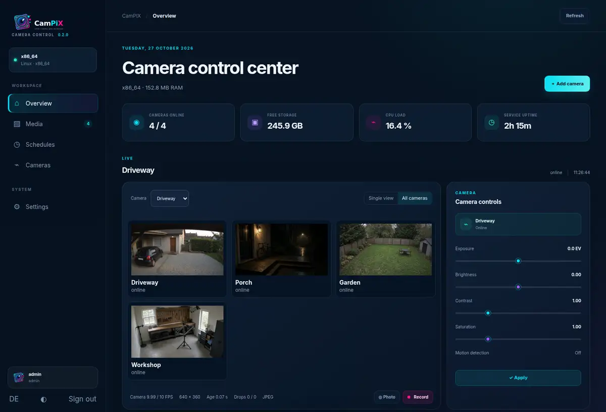

# CamPiX


**One interface. The live view, the recording, and the library.**

[](LICENSE)
[](#live)
[](#recording)

CamPiX is the camera appliance for Raspberry Pi and Linux, with webcams on Windows and macOS and network cameras everywhere. It shows what the device actually reports, then keeps photos, H.264 recordings, motion, and schedules in one place.

## Live


## Every camera



## Recording


## Library


These clips are the running interface. The scenes are illustrative, so the layout is visible without a test pattern. They are not a hardware test.

## Install

Linux and macOS:

```sh
curl -fsSL https://raw.githubusercontent.com/DensenDeluxe/CamPiX/main/install.sh | bash
```

Windows PowerShell:

```powershell
& ([scriptblock]::Create((Invoke-RestMethod https://raw.githubusercontent.com/DensenDeluxe/CamPiX/main/install.ps1)))
```

Open <http://127.0.0.1:8080>. The first start asks for an administrator and the cameras it can see.

[Deployment](docs/DEPLOYMENT.md) · [Home Assistant](docs/DEPLOYMENT.md#home-assistant) · [Architecture](docs/ARCHITECTURE.md) · [Security](docs/SECURITY.md) · [Release readiness](docs/RELEASE-READINESS.md) · [Contributing](CONTRIBUTING.md)

## License

Source code is [MIT](LICENSE). Original copyright notices for Silvan Melchior and Robert Tidey stay in the license. Graphics are catalogued in the [asset guide](pictures/README.md).
