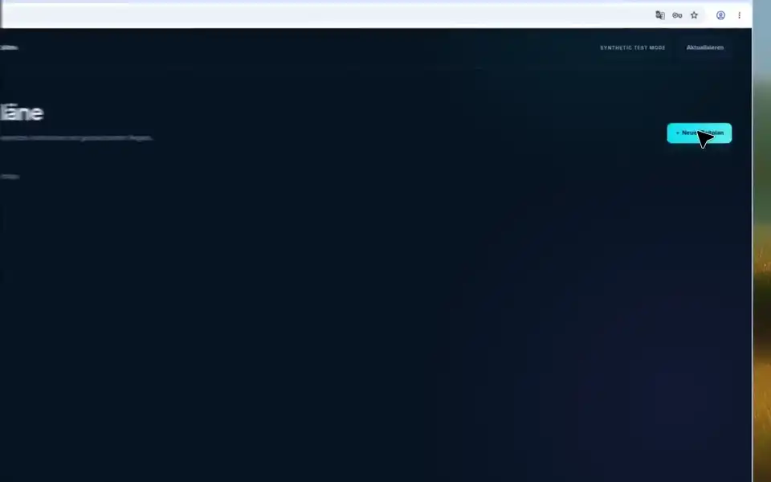

# CamPiX


_One Interface. Every Pi. More Cameras._

**Camera control, recording, and streaming for Raspberry Pi and Linux.**

CamPiX brings live view, camera controls, snapshots, video recording, motion detection, schedules, and a persistent media library into one authenticated web interface. Its `campixd` service discovers camera capabilities instead of assuming compatibility from a board or sensor name.

[](LICENSE)
[](#live-streaming)
[](#features)

[Quick start](#quick-start) · [Schedules](#schedules) · [Home Assistant](#home-assistant) · [Documentation](docs/README.md) · [Deployment](docs/DEPLOYMENT.md) · [Release readiness](docs/RELEASE-READINESS.md) · [Research](docs/deep-research-report.md)

> Version 0.2.0 is an integrated software release candidate, not a blanket production certification. The banner expresses the project's intended reach; it does not certify every Raspberry Pi, Arducam module, or third-party camera. See the [release evidence and remaining validation gates](docs/RELEASE-READINESS.md).

## Why CamPiX?

The familiar camera-appliance workflow should not depend on an obsolete camera stack. CamPiX separates camera capture, recording, analysis, and media transport from its web API, while keeping the operator experience in one place. Physical devices report their actual connection state and available controls; synthetic cameras exist only in explicit demo mode.

## Features

- **Capture adapters:** Picamera2/libcamera, Linux V4L2, Windows DirectShow webcams through FFmpeg, RTSP/HTTP network sources, and an existing local legacy JPEG preview. Independent capture workers reconnect after failures.
- **Photos and recordings:** real JPEG snapshots and H.264/MP4 files, timed recordings, bounded pre-roll, and motion-triggered recording with renewable post-roll. Optional audio is a separate stream, off unless a profile enables it, and a recording is indexed only after picture and audio both finish.
- **Motion:** a slow background model absorbs lighting changes. A 16×9 ignore mask drops permanently busy cells, and normalized regions still limit the score.
- **Media library:** playback, authenticated downloads, locking, deletion, retention rules, storage-reserve protection, filename search across the whole library, and queued timelapse exports.
- **Camera management:** multiple profiles and controls discovered from the selected adapter, rather than invented hardware support.
- **Schedules:** persistent interval jobs with minute-level time windows, weekdays, and time zones. Rules can be edited in place. Pausing a rule keeps its next run. A recording has to finish before the next interval. The [schedule form](#schedules) selects the days.
- **Home Assistant:** `campixd serve` announces the service on the local network. HACS installs the [custom component](#home-assistant) from this GitHub repository. After one administrator sign-in, it adds and removes camera entities from the live catalog. The password is not stored in Home Assistant.
- **Authenticated control plane:** FastAPI, REST/OpenAPI, WebSocket events, SQLite, system metrics, Argon2id passwords, viewer/operator/admin roles, CSRF protection, and revocable sessions.
- **Optional media server:** supervised, version-pinned MediaMTX for RTSP publishing and authenticated WebRTC/HLS access, with a latest-frame JPEG fallback.
- **Notifications:** a fixed catalog — motion, stalled capture, storage reserve, and failed export — can be delivered as a signed webhook or as local SMTP mail. No macros or custom commands.
- **Web interface:** responsive desktop and mobile layouts, dark/light themes, English/German localization, sensor controls reported by the camera, drawable motion regions, a single live view, a JPEG wall for every camera, and the supplied CamPiX branding. No frontend build or external CDN is required.

## Schedules

The schedule form selects weekdays. Monday is 0. Pausing or editing a rule keeps its next run when the interval stays the same. A new recording has to be shorter than its interval.

This animation uses explicit synthetic demo input and the German interface. Saturday and Sunday are cleared, the rule is saved as Werktage, and pausing leaves Monday through Friday on the card.



## Home Assistant

`campixd serve` announces `_campix._tcp.local` unless discovery is turned off with `CAMPIX_MDNS=false` or `"mdns": false` in the configuration file. In HACS, open Integrations, choose Custom repositories, and add `https://github.com/DensenDeluxe/CamPiX` with category Integration. This repository has no GitHub release, so the HACS download button requests `archive/refs/heads/` plus the latest 7-character commit and GitHub returns 404. Download `https://github.com/DensenDeluxe/CamPiX/archive/refs/heads/main.zip` and copy `custom_components/campix` over Home Assistant's `config/custom_components/campix`, then restart Home Assistant. Open the discovered service and enter the CamPiX administrator once. CamPiX creates one revocable viewer token and does not store the password in Home Assistant. The component then creates one camera entity per catalog camera and follows cameras that are added or removed. Still images and the live view send that token.

The announcement carries the service id, version, and catalog path. A listener on all interfaces advertises one private IPv4 address. A listener on loopback advertises loopback, so Home Assistant on another machine needs a reachable CamPiX address. Full steps, token revocation, and the address rules are in the [Home Assistant deployment guide](docs/DEPLOYMENT.md#home-assistant).

## Quick start

The all-in-one installer prepares the available platform profile, installs FFmpeg, the application, and verified MediaMTX by default, and guides you through creating the first administrator and registering discovered cameras. It uses the operating system's camera packages where available; unknown sensors and vendor drivers require their manufacturer's documented setup. No default password or synthetic camera is created.

The remote entrypoints below become available when this installer revision is published to `main`. They have been added to this checkout; this documentation does not claim that they are already published.

### Linux and macOS

```sh
curl -fsSL https://raw.githubusercontent.com/DensenDeluxe/CamPiX/main/install.sh | bash
```

### Windows PowerShell

```powershell
& ([scriptblock]::Create((Invoke-RestMethod https://raw.githubusercontent.com/DensenDeluxe/CamPiX/main/install.ps1)))
```

Run the installer as your normal user, in an interactive terminal. It requests elevation for system-package operations. The entrypoint resolves the requested Git reference once and installs from a fresh detached checkout. `CAMPIX_REF` selects an explicit tag or commit for an application release; the default follows `main`.

After successful setup and service startup, open <http://127.0.0.1:8080>. Raspberry Pi and Debian-family systems use a native package and systemd. Other supported profiles use a private installation and start at user login through a systemd user service, macOS LaunchAgent, or limited Windows scheduled task. Windows detects USB and integrated webcams through FFmpeg's DirectShow input. macOS detects local cameras through FFmpeg's AVFoundation input and also accepts network sources. Local Picamera2 and V4L2 capture require Linux.

For download-and-inspect commands, supported profiles, offline planning, backups, and recovery, see [installation and operations](docs/DEPLOYMENT.md). The installer can discover a board and devices, but physical-camera compatibility and performance still require validation on that host.

### Test this checkout

The Python installer accepts a read-only plan without bootstrap downloads or package changes:

```sh
python scripts/install.py --dry-run
```

Use Python 3.11 or newer (`python3` on systems that use that executable name). Actual installation with `python scripts/install.py` requires a clean committed checkout; it rejects uncommitted changes. Running `bash install.sh` or `./install.ps1` instead prepares a separate checkout of `CAMPIX_REF`.

Always open the interface through `campixd`. Opening `dist/index.html` directly or using a static file server does not provide the authenticated API.

## Camera paths and compatibility

| Source                                                                 | Implemented path                                                      | Qualification boundary                                                                           |
| ---------------------------------------------------------------------- | --------------------------------------------------------------------- | ------------------------------------------------------------------------------------------------ |
| Raspberry Pi CSI; libcamera-compatible official or third-party modules | Picamera2/libcamera                                                   | Host drivers, sensor tuning, controls, and performance must be tested on the actual combination. |
| USB/UVC or a standard Linux capture device                             | V4L2 compressed capture or OpenCV with `v4l2-ctl` controls            | Available formats and controls depend on the device and driver.                                  |
| USB or integrated webcam on Windows                                    | FFmpeg DirectShow input at the native sizes the device reports        | Modes depend on the device and driver; no image controls; one integrated webcam measured.        |
| USB or integrated camera on macOS                                      | FFmpeg AVFoundation input at a numeric device index                   | Discovery lists devices. Image controls and physical qualification are separate.                 |
| IP camera or network stream                                            | FFmpeg RTSP/HTTP(S) decoder                                           | Reconnection is implemented; individual camera models still require qualification.               |
| Existing legacy installation                                           | Local JPEG preview and a restricted authenticated HTTP command facade | Not a complete MMAL/FIFO daemon or migration/import tool.                                        |
| Synthetic input                                                        | Explicit `--demo` adapter                                             | Software test input, never evidence of physical camera compatibility.                            |

Encoder selection `auto` prefers a hardware H.264 encoder that passes a bounded packet-producing probe at the requested profile, then falls back to software `libx264`. Supported FFmpeg paths are NVIDIA NVENC, Intel QSV, AMD AMF, macOS VideoToolbox, Linux VAAPI, and V4L2 M2M; actual usability depends on the installed driver/device. The settings view allows an explicit software or hardware choice, and camera details report the selected codec and fallback reason. Encoder probes do not qualify a camera or guarantee sustained FPS.

Each camera now supplies one shared H.264 stream to live publishing and recording. Native Picamera2 output and reported, matching H.264 UVC profiles bypass a second encoder; JPEG sources use one profile-probed FFmpeg encoder. Matching MJPEG bytes bypass capture recompression, and motion analysis uses a separate small preview. Supported hardware JPEG decoding keeps decoded frames on the GPU only after a packet-producing probe; native CSI reports DMABUF zero-copy only for its actual V4L2 encoder. Compressed buffers and containers still use application memory. Full-resolution photos remain separate from the small native preview. Physical CSI/UVC qualification, AI inference, ONVIF, and vendor GStreamer adapters remain separate work. See [hardware encoding and throughput](docs/DEPLOYMENT.md#hardware-encoding-and-throughput), [architecture](docs/ARCHITECTURE.md), and the [implementation matrix](docs/RELEASE-READINESS.md#research-to-implementation-matrix).

## Live streaming

The browser can display current JPEG frames through the authenticated application without MediaMTX. It requests one frame at a time and cancels pending work when the camera, view, or tab changes. This prevents multipart browser buffering from replaying an old live view. The authenticated `/stream.mjpg` endpoint remains available for other clients.

Use **Fullscreen** above the live image to enlarge JPEG, WebRTC, or native HLS playback. **Exit fullscreen** remains inside the image; Escape also returns to the overview. Browsers that cannot open native fullscreen expand the live view within the current window. Entering or exiting fullscreen keeps the current stream running. Session expiry closes fullscreen.

Optional MediaMTX v1.21.2 adds RTSP publishing, WebRTC/WHEP, and HLS. Automatic mode prefers WebRTC; the live publisher uses wall-clock timestamps when frames are skipped. The managed server is loopback-only; remote WebRTC needs a separately secured MediaMTX deployment with reachable ICE addresses and, where required, TURN. HLS currently uses native browser support, with latest-frame JPEG fallback elsewhere. See the [latency and recovery behavior](docs/DEPLOYMENT.md#live-view-latency-and-recovery) for overload and connection limits.

See [MediaMTX setup](docs/DEPLOYMENT.md#optional-mediamtx) before exposing any media ports. A running HTTP health check does not prove that a camera or streaming path is ready.

## Deployment and security

CamPiX includes a native `.deb` builder, systemd unit, non-root Docker image, local Docker Compose template, and an Nginx TLS template. Native packages are tied to their build architecture and Python minor version; an amd64 build is not a Raspberry Pi arm64 release.

The initial listener is local-only. LAN or public access requires HTTPS, secure cookies, a configured public origin, and an appropriately restricted reverse proxy. Do not expose the application or MediaMTX ports directly to the internet.

Read the [deployment guide](docs/DEPLOYMENT.md), [security model](docs/SECURITY.md), and [production validation checklist](docs/RELEASE-READINESS.md#remaining-production-gates) before operating a physical camera installation.

## Development and verification

Development setup is separate from the installer. Install Python 3.11 or newer, `uv`, and FFmpeg with `libx264` plus `ffprobe`, then run from the repository root:

```powershell
uv sync --locked --extra test --extra v4l2
.venv\Scripts\campixd.exe init-admin
.venv\Scripts\campixd.exe serve --demo
```

`--demo` explicitly enables synthetic input; snapshots, encoded videos, and database records are real. Omit it for normal operation and add a camera in the administrator's **Cameras** view. On Linux, use `.venv/bin/campixd`. CSI capture needs the [native Debian profile](docs/DEPLOYMENT.md#native-debian-package-for-raspberry-pi-and-linux); the locked development environment is not a replacement for distribution-matched camera ABIs.

Run verification in the locked environment:

```powershell
uv lock --check
.venv\Scripts\python.exe -m pytest -q
npm ci --ignore-scripts
npx playwright install chromium
npm run check
npm run check:docs
npm run format:check
npm test
.venv\Scripts\python.exe -m build --wheel --outdir packages
```

On Linux, use `.venv/bin/python` instead. Set `CAMPIX_TEST_CHROME` to an existing Chrome executable to avoid downloading Chromium. Set `CAMPIX_TEST_MEDIAMTX_BINARY` to the verified v1.21.2 binary to enable the optional media-server integration cases. Missing optional tools produce explicit skips, not successful integration results. Run the Python and browser suites sequentially when using managed MediaMTX: its loopback ports are fixed.

Build native packages on a matching Linux host with `scripts/build-deb.py`. Contributor setup, test expectations, and documentation conventions are in [CONTRIBUTING.md](CONTRIBUTING.md).

## Project layout

```text
src/campix/       Service, capture adapters, recording, auth, scheduling, media plane
dist/            Served web interface and runtime branding assets
custom_components/campix/  Home Assistant integration installed by HACS
hacs.json        HACS name and minimum Home Assistant version
tests/           API, recovery, media-server, and browser integration tests
install.sh       Unix one-command bootstrap
install.ps1      Windows one-command bootstrap
scripts/         Installer, packaging, smoke checks, and verified MediaMTX download
packaging/       Native configuration, systemd, Nginx, and package lifecycle files
docs/            Architecture, operations, security, release evidence, and research
docs/media/      Animated schedule-form preview used in this README
pictures/        Supplied source graphics, badges, and design iterations
```

## Origins and direction

CamPiX draws on the workflows and compatibility lessons of [RPi_Cam_Web_Interface_Rework](https://github.com/DensenDeluxe/RPi_Cam_Web_Interface_Rework), which originates from [RPi Cam Web Interface](https://github.com/silvanmelchior/RPi_Cam_Web_Interface). The [branch and commit analysis](docs/REPOSITORY-ANALYSIS.md) distinguishes the merged `rpicamd` work from the unmerged Pinhole replacement.

The [research report](docs/deep-research-report.md) defines the long-term direction, not a completed-feature list. The first integrated core uses Python/FastAPI for direct Picamera2 integration and buildless JavaScript for the web interface. These choices deliberately differ from the report's proposed Rust/Go and TypeScript/PWA stack.

## License and credits

Source code is distributed under the [MIT License](LICENSE). Original copyright notices for Silvan Melchior and Robert Tidey are retained. Dependencies keep their own licenses; the MediaMTX downloader preserves its upstream license. Supplied graphics and their intended use are documented in the [asset guide](pictures/README.md).
