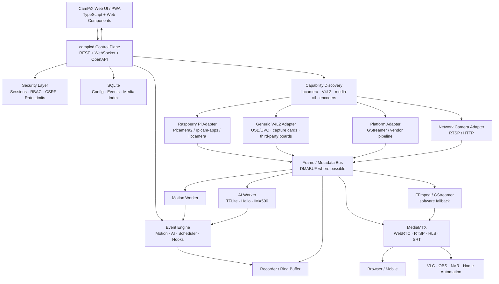
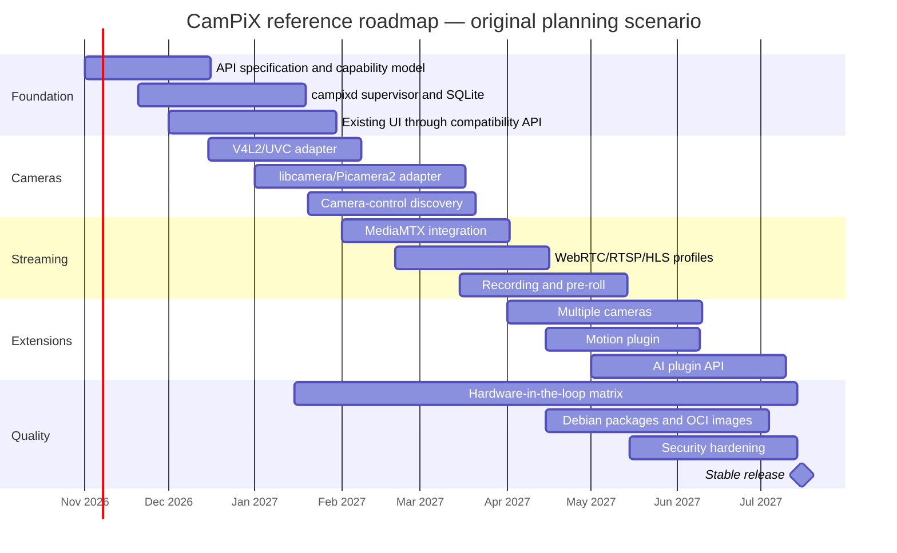
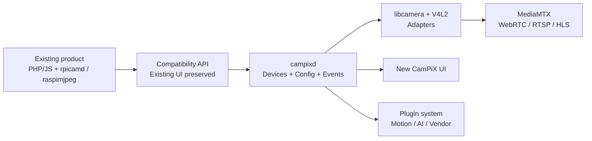

# CamPiX and the ecosystem of universal camera web interfaces for Raspberry Pi and Linux


**Original research snapshot: 11 October 2026, Europe/Berlin.** This English edition preserves the original ecosystem analysis, architecture proposals, milestones, and performance targets. It is a research document, not an implemented-feature list or hardware certification. See [release readiness](RELEASE-READINESS.md) for the actual 0.2.0 scope and [architecture](ARCHITECTURE.md) for deliberate implementation differences.

The original report examined current and historical GitHub projects, prioritizing primary sources from Raspberry Pi, libcamera, Picamera2, Arducam, and project maintainers. German primary documentation was preferred where useful; the authoritative camera-stack documentation is predominantly English. Historical activity/version observations below have not been re-established as a new repository audit during this translation. Unresolvable conversation-local citation markers and an unavailable sandbox chart have been replaced with usable primary-source links and the comparison matrix. The [source directory](#primary-source-directory) identifies the principal references without claiming to reconstruct every original search result.

## Executive summary

The central research finding was that **no single surveyed open-source project consistently combined the classic RPi Cam Web Interface workflow, modern libcamera/Picamera2 controls, generic V4L2 support for USB and third-party hardware, WebRTC/RTSP/HLS, multiple cameras, motion/timelapse/scheduling, AI inference, and a modern authenticated web interface**. Existing projects were strong in distinct areas. This is the report's survey conclusion, not a continuously updated market claim.

That creates a useful starting point for **CamPiX**. The existing `RPi_Cam_Web_Interface_Rework` fork already has a broad scope: modern UI, photos, video, timelapse, motion detection, scheduling, and media management, plus the Picamera2/libcamera-oriented `rpicamd` backend and USB V4L2 support. Its snapshot README listed Raspberry Pi 1/2/3/4/5, the Zero family, Compute Modules, official cameras, several Arducam sensors, USB/UVC, and other Linux boards through V4L2. It also described `rpicamd` as new and not tested on every board/camera combination. [Upstream Rework README](https://github.com/DensenDeluxe/RPi_Cam_Web_Interface_Rework).

**The main opportunity is to build CamPiX as a universal control plane over replaceable capture and media backends, not another monolithic camera program.** Raspberry Pi should use libcamera/Picamera2 or `rpicam-apps`; generic Linux should use V4L2; NVIDIA Jetson and other specialist platforms could later receive GStreamer-specific adapters. Protocol distribution should reuse existing infrastructure. MediaMTX provides WebRTC, RTSP, RTMP, HLS/LL-HLS, SRT, RTP, MPEG-TS, recording, playback, authentication, an API, and parallel stream paths. Raspberry Pi documents MediaMTX integration, including direct camera access through libcamera. [MediaMTX](https://github.com/bluenviron/mediamtx), [Raspberry Pi camera software](https://www.raspberrypi.com/documentation/computers/camera_software.html).

The **Raspberry Pi 5** is a particularly important architectural case. It has greater CPU, GPU, ISP, and I/O capacity than Pi 4, but **does not have Pi 4's H.264 hardware encoder**. Raspberry Pi documents approximately 30–40% CPU for BCM2712 H.264 1080p30 encoding and describes Pi 5 video encoders as software encoders. Pi 4 instead has a hardware H.264 1080p30 encoder. Poorly designed “Pi 5-optimized” H.264 streaming can therefore use more CPU than the Pi 4 path. These figures are upstream context, not measured CamPiX performance. [Processor documentation](https://www.raspberrypi.com/documentation/computers/processors.html), [Camera software](https://www.raspberrypi.com/documentation/computers/camera_software.html).

Universal CamPiX support should be based on **capabilities rather than product names**. Decisions should ask which cameras libcamera exposes, whether V4L2 capture exists, which pixel formats are available, whether V4L2 M2M hardware encoding and DMABUF exist, and how many media-controller pipelines are present. This also provides a principled path for Arducam, compatible third-party modules, USB webcams, and other SBCs. libcamera abstracts heterogeneous Linux camera pipelines behind a modern camera framework. [libcamera](https://libcamera.org/), [Picamera2](https://github.com/raspberrypi/picamera2).

### Prioritized technical direction

| Priority  | Recommendation                                               | Rationale                                                                       |
| --------- | ------------------------------------------------------------ | ------------------------------------------------------------------------------- |
| Very high | Treat libcamera/Picamera2 and V4L2 as equal capture classes. | Covers Pi, compatible Arducam/third-party modules, and USB devices.             |
| Very high | Use MediaMTX as an optional media plane.                     | Reuse established transports rather than rebuilding them.                       |
| Very high | Detect capabilities automatically.                           | Sensor, encoder, and platform capabilities matter more than a board list.       |
| High      | Prefer native `.deb` packages for Pi distribution.           | Picamera2 and the underlying libcamera packages must match the distribution.    |
| High      | Prefer WebRTC live view with a universal MJPEG fallback.     | Improve latency/bandwidth while retaining broad compatibility.                  |
| High      | Manage Pi 5 encoding explicitly.                             | CPU-based H.264 needs low-latency options and load control.                     |
| Medium    | Isolate motion and AI as plugins/workers outside capture.    | Keep OpenCV/TFLite/Hailo/IMX500 optional and avoid reducing core compatibility. |
| Medium    | Keep legacy MMAL as an isolated compatibility plugin.        | The old camera stack must not define the modern core.                           |

These are recommendations; the [implementation matrix](RELEASE-READINESS.md#research-to-implementation-matrix) records which parts are present today.

## Repository landscape and priorities

The ranking evaluates **relevance to CamPiX**, not popularity alone: camera integration, architecture, maintenance, protocols, and reusable concepts.

A methodological limitation of the original survey was that unauthenticated GitHub HTML exposed latest-commit headings and history but did not always expose a crawler-readable HEAD date. Such dates were recorded as _not verified_ rather than guessed, with independently observed activity where available. For example, the original survey recorded µStreamer as updated on 10 October 2026. Counts, activity labels, and issue observations are snapshot notes, not live statistics.

| Priority                  | Project                                                                                        | Commit/version snapshot                                                        | Maintainer                                          | Language/license                                                                | Activity snapshot                                                      | Hardware/cameras                                                                                                                                      | Main functions/deployment                                                                                                                          | Important limitations                                                                                                                   |
| ------------------------- | ---------------------------------------------------------------------------------------------- | ------------------------------------------------------------------------------ | --------------------------------------------------- | ------------------------------------------------------------------------------- | ---------------------------------------------------------------------- | ----------------------------------------------------------------------------------------------------------------------------------------------------- | -------------------------------------------------------------------------------------------------------------------------------------------------- | --------------------------------------------------------------------------------------------------------------------------------------- |
| A                         | [CamPiX workflow basis / Rework](https://github.com/DensenDeluxe/RPi_Cam_Web_Interface_Rework) | HEAD date not verified; README at 7.1.0                                        | DensenDeluxe; fork of silvanmelchior                | C/C++/PHP/JS/Shell; license file present, SPDX not established from survey HTML | Active development                                                     | Pi 1–5, Zero/Zero 2, CM family; Pi 400/500 via USB; OV5647/IMX219/IMX477/IMX708/IMX296/IMX500; listed Arducam sensors; UVC; other Linux SBCs via V4L2 | Live view, photos, video, timelapse, motion, scheduler, gallery, responsive DE/EN UI, server-side roles, HTTP API; Apache/Nginx/lighttpd installer | `rpicamd` not qualified on every combination; Pi 5 software H.264; rotation/motion behavior differs from legacy.                        |
| A                         | [MediaMTX](https://github.com/bluenviron/mediamtx)                                             | HEAD date not verified; survey observed issues into September 2026             | bluenviron                                          | Go; MIT                                                                         | Very high; survey recorded roughly 20,000 stars and over 3,000 commits | Cross-platform; native `rpiCamera` source or network/encoder sources                                                                                  | WebRTC, RTSP, RTMP, LL-HLS/HLS, SRT, RTP, MPEG-TS, MoQ; recording/playback; JWT/HTTP/internal auth; API, metrics, hooks; single binary/Docker      | Not a camera-control UI; NAT/WebRTC and specialist setup are complex; survey noted LL-HLS/recording bug reports.                        |
| A                         | [camera-streamer](https://github.com/ayufan/camera-streamer)                                   | HEAD date not verified; v0.4.0/Trixie activity recorded in 2026                | ayufan                                              | C/C++; GPL-3.0                                                                  | Medium to high                                                         | Raspberry Pi CSI/libcamera and UVC, especially Pi/OctoPrint                                                                                           | Accelerated MJPEG/H.264, WebRTC, RTSP, HTTP; libcamera/ISP pipeline; Debian packages                                                               | README describes less complete support than µStreamer; survey noted a Trixie/libcamera IPA package conflict.                            |
| A/B                       | [motionEye](https://github.com/motioneye-project/motioneye)                                    | HEAD date not verified; 0.44.0 recorded on 20 June 2026, issues into September | motioneye-project; MichaIng active                  | Python/JS; GPL-3.0                                                              | High                                                                   | Linux/V4L2, USB, network cameras; native Pi integration less direct                                                                                   | Web NVR, motion, recording, snapshots, multiple cameras, schedules, auth/API; Docker/pip/systemd                                                   | `motion` traditionally expects V4L2; native libcamera and Pi 5 acceleration need care; 0.44 included significant auth/security changes. |
| B                         | [µStreamer](https://github.com/pikvm/ustreamer)                                                | Survey recorded an update on 10 October 2026                                   | PiKVM / mdevaev                                     | C; GPL-3.0                                                                      | Very high                                                              | Broad V4L2/USB/UVC; CSI only through an appropriate exposed/wrapped source                                                                            | Efficient MJPEG HTTP streaming, Pi hardware JPEG/M2M, UNIX socket/systemd, multiarch Docker                                                        | Not full camera management; fewer controls than mjpg-streamer; native libcamera sensor control is not its focus.                        |
| B                         | [Picamera2](https://github.com/raspberrypi/picamera2)                                          | HEAD date not verified; survey snapshot recorded 690 commits                   | Raspberry Pi                                        | Python; BSD-2-Clause                                                            | High; official stack                                                   | Pi boards down to Zero; Bullseye or newer; official/libcamera-compatible sensors                                                                      | Python configuration, controls, streams, recording, encoders, processing; primarily APT installation                                               | No web UI; not a generic clone-SBC API; distribution versions must match; survey README still called it beta.                           |
| B                         | [rpicam-apps](https://github.com/raspberrypi/rpicam-apps)                                      | Ongoing official stack                                                         | Raspberry Pi                                        | C++; BSD-2-Clause                                                               | High; official                                                         | Pi libcamera pipeline, official/supported third-party sensors                                                                                         | Photos/video/raw, streaming, libav/GStreamer, postprocessing, multiple-camera foundations; optional TFLite/OpenCV/Hailo                            | No web UI; Pi 5 H.264 is software; more integration work than Picamera2.                                                                |
| C                         | [ArduCAM/mjpg-streamer](https://github.com/ArduCAM/mjpg-streamer)                              | HEAD date not verified                                                         | ArduCAM                                             | C/C++; GPL-2.0                                                                  | Vendor/niche fork                                                      | UVC, legacy `input_raspicam`, and `input_libcamera`                                                                                                   | MJPEG/HTTP, file output, OpenCV/UVC/libcamera input                                                                                                | README warns against untrusted networks; RTSP/UDP outputs are marked nonfunctional.                                                     |
| C                         | [jacksonliam/mjpg-streamer](https://github.com/jacksonliam/mjpg-streamer)                      | HEAD date not verified; legacy project with open PRs/issues                    | jacksonliam and community                           | C; GPL-2.0                                                                      | Low to medium                                                          | Strong UVC/MJPEG; Pi plugin originates in the legacy era                                                                                              | MJPEG HTTP, plugins, file output, UVC/OpenCV                                                                                                       | Default setup is unsuitable for untrusted networks; `input_raspicam` is legacy; RTSP is not a dependable modern primary path.           |
| C; historically important | [RPi Cam Web Interface](https://github.com/silvanmelchior/RPi_Cam_Web_Interface)               | HEAD date not verified; historical project                                     | silvanmelchior and community, including roberttidey | C/PHP/JS/Shell                                                                  | Legacy                                                                 | Classic Pi cameras via raspimjpeg/MMAL                                                                                                                | Workflow reference: live preview, photos/video, timelapse, motion, scheduler, media management                                                     | Bullseye's libcamera transition broke legacy assumptions; the Rework addresses that transition.                                         |

The ecosystem has six useful roles. The Rework is the workflow reference for a full camera appliance. Picamera2/rpicam-apps provide the authoritative Pi camera APIs. camera-streamer demonstrates low-latency hardware pipelines. µStreamer is the lightweight generic V4L2/MJPEG reference. MediaMTX provides media transport. motionEye is the reference for surveillance, recording, and event workflows.

Arducam is also relevant for autofocus, external triggers, strobes, and calibration capabilities. “Arducam support” should not be a UI-level special case: when libcamera recognizes a sensor and exposes its controls, CamPiX should adopt those capabilities dynamically. Vendor-specific functions still require documented driver and module qualification. [Arducam documentation](https://docs.arducam.com/).

## Hardware, camera, and driver compatibility

The fundamental Pi camera transition is **MMAL → libcamera**. Picamera2 is the libcamera-based replacement for the original Picamera interface and targets Raspberry Pi OS Bullseye or newer, not legacy images or a re-enabled legacy stack. Official camera applications use the `rpicam-*` names from Bookworm. A modern universal interface must treat libcamera as the current stack and MMAL as isolated legacy support. [Picamera2](https://github.com/raspberrypi/picamera2), [Raspberry Pi camera software](https://www.raspberrypi.com/documentation/computers/camera_software.html).

### Platform considerations

This table describes upstream platform characteristics and research recommendations, not measured CamPiX compatibility.

| Platform                   | CPU/GPU/media                                                                | Camera I/O                                                 | Modern stack                                                   | Encoding context                                                                                                             | CamPiX recommendation                                                           |
| -------------------------- | ---------------------------------------------------------------------------- | ---------------------------------------------------------- | -------------------------------------------------------------- | ---------------------------------------------------------------------------------------------------------------------------- | ------------------------------------------------------------------------------- |
| Pi 1 / Zero / Zero W / CM1 | BCM2835, ARM1176 single core; VideoCore IV                                   | CSI on equipped boards                                     | Picamera2/libcamera can reach the Zero, with lower performance | Older VideoCore paths; CPU/RAM are bottlenecks                                                                               | Worth targeting, but reduce UI processing, AI, and transcoding.                 |
| Pi 2                       | Early BCM2836 Cortex-A7 ×4; later A53 revisions; VideoCore IV                | CSI                                                        | libcamera/Picamera2                                            | Older VideoCore/V4L2 media path                                                                                              | Basic streaming; minimize browser transcoding.                                  |
| Pi 3 / 3+ / CM3            | Cortex-A53 ×4, approximately 1.2–1.4 GHz; VideoCore IV                       | CSI; CM routing depends on carrier                         | libcamera/Picamera2                                            | Older hardware H.264 pipeline                                                                                                | Candidate minimum for a 1080p appliance without heavy AI.                       |
| Zero 2 W                   | RP3A0, Cortex-A53 ×4 at 1 GHz; 512 MB                                        | CSI-2                                                      | libcamera/Picamera2                                            | Upstream H.264 encode/decode up to 1080p30                                                                                   | Attractive low-cost target; constrain memory carefully.                         |
| Pi 4 / CM4                 | BCM2711, Cortex-A72 ×4; VideoCore VI                                         | Pi 4 exposes one CSI port; CM4 offers flexible routing     | libcamera/Picamera2, VC4 ISP                                   | Hardware H.264 1080p30 encoding and H.265 4Kp60 decoding                                                                     | Particularly attractive for a native H.264 path.                                |
| Pi 5 / CM5                 | BCM2712, Cortex-A76 ×4 at 2.4 GHz; VideoCore VII; Pi ISP up to 1 gigapixel/s | Pi 5: two four-lane MIPI camera/display transceivers       | libcamera PiSP pipeline                                        | HEVC 4Kp60 hardware decode; other codecs, including H.264 encode, use software; upstream 1080p30 estimate roughly 30–40% CPU | Multi-camera/AI target, but encoding strategy must differ from Pi 4.            |
| Pi 400 / 500               | Pi 4/Pi 5 class, desktop form factor                                         | No standard CSI connector                                  | USB/V4L2                                                       | Generation/source dependent                                                                                                  | Use USB/UVC or network cameras.                                                 |
| Compute Modules            | Generation dependent, CM1–CM5                                                | Carrier-dependent MIPI routes; useful for multiple cameras | libcamera                                                      | Generation dependent                                                                                                         | Important industrial targets; qualify carrier routing and concurrent pipelines. |

See [Raspberry Pi processors](https://www.raspberrypi.com/documentation/computers/processors.html), [Pi 5 specifications](https://www.raspberrypi.com/products/raspberry-pi-5/), and [camera software](https://www.raspberrypi.com/documentation/computers/camera_software.html) for upstream context.

Document **GPU, VPU, and ISP** separately. A faster 3D GPU does not imply hardware video encoding. Pi 5 has a faster VideoCore VII 3D block and a stronger ISP while still encoding H.264 in software. An unqualified “GPU accelerated” badge would be misleading.

> Pi 4 and Pi 5 are not a simple linear performance progression for H.264 encoding.

Raspberry Pi's streaming examples use `v4l2h264enc` for Pi 4 and earlier and `x264enc` for Pi 5. Pi 5 also has low-latency options to mitigate software-encoder latency. [Camera software documentation](https://www.raspberrypi.com/documentation/computers/camera_software.html).

### CSI, USB, and third-party cameras

**CSI/MIPI** sensors commonly deliver raw Bayer data. ISP integration, sensor controls, 3A algorithms, tuning, and the media-controller pipeline belong to platform integration. libcamera exists to coordinate those complex Linux camera pipelines. [libcamera](https://libcamera.org/).

**USB/UVC** cameras often perform more processing internally. UVC is therefore a useful generic fallback: open V4L2, query supported formats/controls, and handle JPEG/YUYV/H.264 as the device allows. µStreamer demonstrates this broad V4L2 approach. [µStreamer](https://github.com/pikvm/ustreamer).

Arducam and other compatible modules need several distinct paths:

| Device situation                            | CamPiX strategy                                                                           | Expected integration maturity, not test status |
| ------------------------------------------- | ----------------------------------------------------------------------------------------- | ---------------------------------------------- |
| Sensor fully recognized by Pi libcamera     | Native libcamera/Picamera2; discover controls dynamically                                 | High                                           |
| Vendor supplies kernel/libcamera extensions | Use native pipeline; document versions and tuning                                         | Medium to high                                 |
| Device exposes UVC `/dev/video*`            | Generic V4L2 adapter                                                                      | High                                           |
| CSI on a non-Pi SBC                         | Claim support only when kernel, media controller, sensor, ISP, and pipeline work together | Highly board dependent                         |
| Proprietary vendor stack                    | Plugin/GStreamer adapter, not special cases in the core                                   | Platform dependent                             |

libcamera may identify the sensor without identifying the exact module. NoIR variants and third-party boards can require different tuning files; Raspberry Pi documents third-party sensor tuning. [Camera software](https://www.raspberrypi.com/documentation/computers/camera_software.html).

The Rework already uses a practical prerequisite: Arducam or other libcamera sensors must be listed by `rpicam-hello --list-cameras`. This is more defensible than “supports every Arducam camera,” but discovery still does not certify every control or operating profile. [Rework camera support](https://github.com/DensenDeluxe/RPi_Cam_Web_Interface_Rework).

For Orange Pi, Banana Pi, Radxa, ODROID, Jetson, and x86, do not promise arbitrary CSI support. Generic USB webcams are a different proposition from a carrier/kernel/vendor-specific CSI path. The Rework similarly limits generic non-Pi CSI use to a usable standard V4L2 capture device.

```text
CSI with a working libcamera pipeline → Native camera adapter
USB/UVC or plain V4L2               → Generic V4L2 adapter
Other-SBC CSI with vendor GStreamer  → Platform plugin
RTSP/IP camera                      → Network-source adapter
Old Raspberry Pi OS / MMAL          → Isolated legacy plugin, not core
```

This avoids confusing a similar 40-pin header or a mechanically matching MIPI connector with complete Raspberry Pi camera compatibility.

## Feature comparison, protocols, and untapped potential

The matrix uses **✓** for a native/core feature, **△** for limited or indirect support, and **—** for no relevant native implementation. Protocol columns primarily describe serving a stream, not merely consuming it: motionEye can ingest RTSP without itself being a modern RTSP server. The Rework row describes the surveyed upstream project, not the implemented CamPiX 0.2.0 application.

| Project               |      HTTP/MJPEG       | Recording |  Timelapse   |     Motion     |  AI/edge   |         WebRTC         |      RTSP       |       HLS       | Auth |  Multiple cameras  |  Scheduler   |   Mobile UI    |    API     | Container |
| --------------------- | :-------------------: | :-------: | :----------: | :------------: | :--------: | :--------------------: | :-------------: | :-------------: | :--: | :----------------: | :----------: | :------------: | :--------: | :-------: |
| Rework workflow basis |           ✓           |     ✓     |      ✓       |       ✓        |     △      |           —            |        —        |        —        |  ✓   |         △          |      ✓       |       ✓        |     ✓      |     △     |
| RPi Cam Web Interface |           ✓           |     ✓     |      ✓       |       ✓        |     —      |           —            |        —        |        —        |  △   |         —          |      ✓       |       △        |     △      |     —     |
| camera-streamer       |           ✓           |     —     |      —       |       —        |     —      |           ✓            |        ✓        |        —        |  △   |         △          |      —       |     Basic      |     —      |     △     |
| motionEye             |           ✓           |     ✓     |      ✓       |       ✓        |     —      |           —            |     △ input     |        —        |  ✓   |         ✓          |      ✓       |       △        |     ✓      |     ✓     |
| µStreamer             |           ✓           |     —     |      —       |       —        |     —      | △ external integration |        —        |        —        |  △   | Separate processes |      —       |     Basic      |     △      |     ✓     |
| MediaMTX              |           △           |     ✓     |      —       |       —        |     —      |           ✓            |        ✓        |        ✓        |  ✓   |         ✓          |    Hooks     | Browser player |     ✓      |     ✓     |
| ArduCAM/mjpg-streamer |           ✓           |     △     |      —       |       —        |  △ OpenCV  |           —            |       —*        |        —        |  △   |         △          |      —       |     Basic      |     —      |     —     |
| mjpg-streamer         |           ✓           |     △     |      —       |       —        |  △ OpenCV  |           —            |    △ legacy     |        —        |  △   |         △          |      —       |     Basic      |     —      | Community |
| Picamera2             |    Building block     |     ✓     | Programmable |  Programmable  | Integrable |           —            | Via media layer | Via media layer |  —   |         ✓          | Programmable |       —        | Python API |     —     |
| rpicam-apps           | Stream building block |     ✓     | Programmable | Postprocessing |     ✓      |       Via server       |   Via server    |   Via server    |  —   |       Basic        |      —       |       —        |    CLI     |     —     |

\* The Arducam fork's README marks `output_rtsp` and `output_udp` as nonfunctional. A limited AI marker is not evidence of a finished object-detection workflow in the Rework. [ArduCAM/mjpg-streamer](https://github.com/ArduCAM/mjpg-streamer).

The classifications follow the projects' descriptions: the Rework provides camera-appliance workflows; camera-streamer advertises MJPEG/H.264, WebRTC, and RTSP; motionEye is a frontend for `motion`; µStreamer concentrates on V4L2/MJPEG; MediaMTX provides a broad protocol/media-server layer. Follow the linked projects in the [repository landscape](#repository-landscape-and-priorities) for details and changing versions.

The original report linked an external sandbox chart that is not present in this repository. The matrix above retains the comparison without a broken image link. **Protocol breadth is not overall product quality**: MediaMTX is a media router, while CamPiX, motionEye, and µStreamer have different core responsibilities. Combining specialized projects is more useful than reimplementing every transport inside `campixd`.

### WebRTC as primary interactive live view

MJPEG is simple and robust but consumes comparatively high bandwidth. A universal CamPiX client should prefer low-latency WebRTC and fall back automatically to HLS or MJPEG. MediaMTX supports this multi-protocol direction, and Raspberry Pi documents streaming-server integration. [MediaMTX](https://github.com/bluenviron/mediamtx), [Camera software](https://www.raspberrypi.com/documentation/computers/camera_software.html).

### Zero-copy and encoder capability detection

Do not blindly launch `ffmpeg -c:v libx264` for every platform. A startup probe should examine V4L2 formats, M2M codecs, DMABUF, and libcamera streams. Pi 4 might then select native hardware H.264, while Pi 5 intentionally uses low-latency software encoding. Current CamPiX implements bounded FFmpeg hardware-encoder/profile probes and automatic hardware preference with software fallback. Native Picamera2 output, matching H.264 UVC passthrough and a shared encoded stream now feed copy-only live and recording consumers. Raw-frame zero-copy is limited to the actual Picamera2 V4L2 DMABUF path or a successfully probed hardware JPEG decoder/encoder pair; physical qualification remains separate. [Implemented architecture](ARCHITECTURE.md).

### Full multiple-camera support

Pi 5's two MIPI transceivers and upstream support for multiple cameras and software synchronization create an opportunity for split view, synchronized snapshots, grouped recordings, master/client synchronization, and shared exposure profiles. Current independent camera profiles do not fulfill all of those coordination proposals. [Raspberry Pi camera software](https://www.raspberrypi.com/documentation/computers/camera_software.html).

### Distinguish AI from motion detection

Pixel/frame differencing is inexpensive and remains useful for a Zero/Pi 2-compatible product. Optional object-classification workers should sit above it. `rpicam-apps` offers OpenCV, TensorFlow Lite, and Hailo integration points. The IMX500 AI Camera also needs sensor-metadata handling rather than being treated only as an ordinary image source. [rpicam-apps](https://github.com/raspberrypi/rpicam-apps), [Raspberry Pi camera software](https://www.raspberrypi.com/documentation/computers/camera_software.html).

### Event recording with pre-roll

A circular RAM/disk buffer should retain footage from before a trigger—for example, five seconds before motion and twenty seconds afterward. This is more useful for surveillance than starting a recording only after detection. The original recommendation did not claim these exact durations as a property of every surveyed project. Current CamPiX has bounded pre-roll and motion post-roll, subject to its implemented limits.

### ONVIF and NVR interoperability

RTSP can already support many NVR workflows. A later ONVIF profile could standardize discovery, stream profiles, and events, moving CamPiX toward a network-camera platform rather than only a web camera application. ONVIF remains a proposal.

### Observability

Combine MediaMTX metrics with CamPiX telemetry for sensor/CPU temperature, throttling, FPS, dropped frames, encoder queues, WebRTC RTT, and disk I/O. Do not imply that the current system exposes every proposed metric. [MediaMTX](https://github.com/bluenviron/mediamtx), [Current release scope](RELEASE-READINESS.md).

### Security as a core feature

mjpg-streamer warns against using its default setup on untrusted networks. The motionEye 0.44 release addressed authentication and path-traversal concerns, strengthened password handling, and protected action endpoints. “It runs on a home network” is not a sufficient security model. [mjpg-streamer](https://github.com/jacksonliam/mjpg-streamer), [motionEye 0.44.0 release](https://github.com/motioneye-project/motioneye/releases/tag/0.44.0).

## Target architecture for CamPiX

Long-term CamPiX should not be defined by `raspimjpeg + PHP + CGI`. The original project's most valuable part is its **operator and feature model**; the technical layers can be decoupled incrementally.

This diagram is a target, not the implemented 0.2.0 component map:



### Control plane

The core should be a standalone **`campixd`** service responsible for discovery, camera lifecycle, configuration, permissions, schedules, the media index, event processing, and process supervision. The frontend should communicate only through a versioned REST/WebSocket API.

For a new native implementation, **Rust or Go** were the report's preferred candidates: Rust for hardware/Linux-heavy logic, Go when development and packaging simplicity dominate. More important than language choice is keeping capture independent of HTTP request handling. Current CamPiX uses Python/FastAPI for direct Picamera2 integration, explicitly differing from that recommendation.

Initially preserve the Rework's HTTP interface as a compatibility layer. Existing image/MJPEG endpoints, commands, and CSRF handling could map to the new model so the old UI remains usable during migration. Current CamPiX provides only a restricted facade, not complete compatibility. [Rework](https://github.com/DensenDeluxe/RPi_Cam_Web_Interface_Rework), [Release readiness](RELEASE-READINESS.md).

### Capture plane

Define four modern adapter classes plus an isolated legacy path:

| Adapter        | Priority | Responsibility                                                                                         |
| -------------- | -------- | ------------------------------------------------------------------------------------------------------ |
| `libcamera-pi` | A        | Native Pi CSI and libcamera-compatible Arducam/third-party sensors; controls, autofocus, raw/metadata. |
| `v4l2`         | A        | UVC webcams, USB capture, and standard devices on other boards.                                        |
| `network`      | B        | RTSP/HTTP cameras.                                                                                     |
| `gstreamer`    | B/C      | Specialist SBCs, Jetson, and vendor pipelines.                                                         |
| `mmal-legacy`  | Legacy   | Old Raspberry Pi OS installations only.                                                                |

A two-stage Pi migration is sensible: first use Picamera2 or `rpicam-apps` as an official API/process building block; later add a direct libcamera C++ adapter only if profiling shows a real benefit. Picamera2 targets the Pi family down to Zero. [Picamera2](https://github.com/raspberrypi/picamera2).

### Media plane

**Bundle MediaMTX optionally, but do not fork it.** Generate configuration or use its API, treating it as replaceable infrastructure.

The upstream server offers:

- WebRTC for browsers;
- RTSP for VLC/NVR/Home Assistant workflows;
- HLS/LL-HLS browser/WAN fallback;
- SRT for resilient WAN transport;
- recording/playback;
- multiple stream paths;
- authentication and a control API;
- Prometheus metrics.

These are MediaMTX capabilities, not a statement that CamPiX enables every protocol. Current managed CamPiX disables SRT, RTMP, and MoQ. [MediaMTX](https://github.com/bluenviron/mediamtx), [Implemented media boundary](ARCHITECTURE.md#media-plane-and-trust-boundary).

Raspberry Pi documents a minimal `source: rpiCamera` configuration in which MediaMTX owns the camera. For CamPiX, prefer that only as a fallback/minimal mode; otherwise camera controls, AI metadata, and multiple-stream coordination become harder to centralize. [Camera software](https://www.raspberrypi.com/documentation/computers/camera_software.html).

### Capability profiles and fallback modes

A future startup probe could produce a machine-readable profile such as the following. It is illustrative, not an actual current API response or proof of raw/AI support:

```json
{
  "platform": {
    "family": "raspberry-pi",
    "model": "Raspberry Pi 5",
    "arch": "aarch64"
  },
  "camera": {
    "backend": "libcamera",
    "sensor": "imx708",
    "autofocus": true,
    "raw": true,
    "streams": 2
  },
  "encoding": {
    "h264": {
      "hardware": false,
      "software": true
    },
    "mjpeg": {
      "available": true
    }
  },
  "transport": {
    "webrtc": true,
    "rtsp": true,
    "hls": true
  }
}
```

Five operating modes could follow:

| Mode             | Typical case            | Intended behavior                                  |
| ---------------- | ----------------------- | -------------------------------------------------- |
| Native           | Pi + libcamera          | Sensor controls, ISP, optimized streams, metadata. |
| Accelerated V4L2 | UVC/V4L2 + M2M          | Hardware encoding and DMABUF where practical.      |
| Generic          | Arbitrary standard V4L2 | Software MJPEG/H.264 according to CPU capacity.    |
| Safe fallback    | Difficult hardware      | MJPEG with reduced resolution/FPS.                 |
| Legacy           | Buster/old stack        | Separate existing raspimjpeg/MMAL path.            |

The goal is for an Orange Pi with a working UVC `/dev/video0` source to use the same standard-device path as x86 or Pi without hard-coded board names. Reliability still needs measured qualification.

## Implementation, performance, and release plan

With budget, team size, and deadline unspecified, a milestone-based plan is more useful than a delivery promise. The original timeline below is a reference scenario beginning in late 2026. It has not been reconciled into a current committed schedule; some foundational components already exist in 0.2.0.



### Performance targets

Treat these as **engineering targets and regression thresholds**, not guaranteed hardware specifications or measured current CamPiX results.

| Platform               | Proposed target                                                                                          |
| ---------------------- | -------------------------------------------------------------------------------------------------------- |
| Pi Zero / Pi 1         | 640 × 480 through 720p; MJPEG or a usable native path; core daemon below 100 MB RAM.                     |
| Zero 2 W               | 720p30 WebRTC/MJPEG and 1080p30 H.264 with a suitable hardware path; aggressive memory limits.           |
| Pi 3                   | Single-camera 1080p30; motion analysis at reduced resolution.                                            |
| Pi 4                   | Hardware H.264 1080p30 with low CPU use and a separate low-resolution motion stream.                     |
| Pi 5                   | Low-latency software H.264 1080p30; CamPiX overhead well below the upstream 30–40% encoder CPU estimate. |
| Pi 5, multiple cameras | Start with 2 × 720p30 or one 1080p stream plus analysis substreams; 2 × 1080p only after profiling.      |
| x86 / powerful SBCs    | 1080p60/4K according to available VAAPI/QSV/NVENC/V4L2 paths.                                            |

Pi 5 hardware CI should measure CPU explicitly because software H.264 has a material encoding budget. A useful browser live-view target would be **under 500 ms LAN glass-to-glass latency over WebRTC**, with MJPEG as a broad compatibility fallback. That is a proposed product target, not a measurement of the surveyed projects or current CamPiX. [Raspberry Pi processor context](https://www.raspberrypi.com/documentation/computers/processors.html).

### Security model

A public CamPiX service should not follow the classic embedded pattern of port 80 with optional Basic Auth.

Recommended foundations are TLS or secure reverse-proxy integration, server-side sessions or short-lived tokens, Argon2id password hashes, `admin/operator/viewer` roles, CSRF protection for cookie sessions, rate limits, secure headers, non-root camera services, systemd sandboxing, and configurable bind interfaces.

The motionEye 0.44.0 changes demonstrate why this is operationally important: stronger password requirements, Argon2, tightened API authentication, and path-traversal fixes. [motionEye release notes](https://github.com/motioneye-project/motioneye/releases/tag/0.44.0).

Keep secrets out of general configuration exports and default network streams to loopback or an explicitly configured interface. Distinguish a sanitized configuration export from a private disaster-recovery backup: the implemented database backup excludes sessions but still contains password hashes and potentially camera credentials. Encrypt and protect it rather than assuming it is secret-free. The report also noted camera-streamer's move toward localhost defaults. [camera-streamer](https://github.com/ayufan/camera-streamer), [Current backup procedure](DEPLOYMENT.md#storage-backups-recovery-and-updates).

### Test matrix

A project claiming broad Raspberry Pi/camera support needs **hardware-in-the-loop**. GitHub Actions alone cannot reproduce libcamera, ISP, encoder, or device-tree integration problems.

| Category          | Proposed minimum test inventory                                                                         |
| ----------------- | ------------------------------------------------------------------------------------------------------- |
| Boards            | Zero W, Zero 2 W, Pi 3B+, Pi 4, Pi 5, CM4 or CM5.                                                       |
| Operating systems | Raspberry Pi OS Trixie 64-bit and Bookworm 64-bit; targeted 32-bit tests.                               |
| Official cameras  | OV5647 v1, IMX219 v2, IMX477 HQ, IMX708 Camera Module 3, IMX296 Global Shutter.                         |
| AI                | IMX500 AI Camera.                                                                                       |
| Arducam           | An autofocus module such as IMX519, one high-resolution model, and one global-shutter/monochrome model. |
| USB               | UVC MJPEG, YUYV, and H.264 devices.                                                                     |
| Other platforms   | At least one generic ARM64 SBC and one x86-64 Linux host.                                               |
| Network           | RTSP H.264/H.265 test sources.                                                                          |

Picamera2's broad Pi coverage does not remove performance differences on smaller devices. Record **FPS, dropped frames, CPU, RAM, temperature, and latency**, not merely pass/fail. [Picamera2](https://github.com/raspberrypi/picamera2).

A proposed three-level CI/CD flow is:

```text
Pull request   → Unit/API/frontend tests       → Cross-compilation
Merge          → QEMU/container integration    → Debian packages
Nightly/release → Physical Pis and cameras     → Compatibility database
```

Hardware-farm results could be written to JSON and used to generate README compatibility tables. Then “tested” becomes a reproducible property rather than a marketing statement. This farm and automated compatibility catalog do not yet exist in CamPiX.

### Packaging

Prefer native Debian packages for Raspberry Pi. A future published package repository might support:

```sh
sudo apt install campix
```

That command is a distribution goal, not an available APT channel in this workspace. Use [the current local `.deb` instructions](DEPLOYMENT.md#native-debian-package-for-raspberry-pi-and-linux).

The intended filesystem layout is:

```text
/usr/bin/campixd
/usr/lib/campix/
/etc/campix/
/var/lib/campix/
/var/lib/campix/media/
/usr/lib/systemd/system/campix.service
```

This fits Picamera2's recommendation to install distribution-matched packages through APT. [Picamera2 installation guidance](https://github.com/raspberrypi/picamera2).

Offer containers as an additional path, not the only one. OCI is attractive for UVC/network cameras; CSI still depends on host kernel, device tree, `/dev/media*`, `/dev/video*`, ISP nodes, and matching libcamera/IPA components. Native Raspberry Pi OS installation should remain the reference path.

Illustrative future image names—not published downloads—are:

```text
ghcr.io/campix/campix:arm64
ghcr.io/campix/campix:armv7
ghcr.io/campix/campix:amd64
ghcr.io/campix/mediamtx:<pinned-version>
```

Do not use uncontrolled `latest` selection in installers. Version tested MediaMTX/FFmpeg/libcamera combinations explicitly.

## Migration and CamPiX branding

**CamPiX** is shorter and more memorable than `RPi_Cam_Web_Interface_Rework` and supports a distinct product identity while keeping provenance visible.

Technical claims should remain more conservative than “supports every camera.” The Rework documents broad intent but acknowledges incomplete `rpicamd` board/camera qualification. [Rework README](https://github.com/DensenDeluxe/RPi_Cam_Web_Interface_Rework).

The original positioning proposal was:

> CamPiX — Universal camera control for Raspberry Pi and Linux

Its suggested short GitHub description was:

> A modern universal camera web interface for Raspberry Pi and Linux — with libcamera, Picamera2, V4L2, official Raspberry Pi cameras, Arducam, USB/UVC and compatible third-party hardware.

For the current implementation, a more evidence-aligned description is:

> Camera control, recording, and streaming for Raspberry Pi and Linux.

The supplied marketing line is:

> One Interface. Every Pi. More Cameras.

“Every Pi” must be supported by an actual compatibility matrix before becoming a release claim. Supplied graphics are used in the [project README](../README.md), [documentation index](README.md), and [asset guide](../pictures/README.md); their scope is explained alongside the current status.

### Repository migration

The original recommendation was eventually to rename:

```text
DensenDeluxe/RPi_Cam_Web_Interface_Rework
```

to a name such as:

```text
DensenDeluxe/CamPiX
```

This is a proposal, not a remote operation performed by this documentation update. Review GitHub's rename behavior and update installer/documentation references before carrying it out; do not assume all integrations follow redirects indefinitely. [GitHub repository rename documentation](https://docs.github.com/en/repositories/creating-and-managing-repositories/renaming-a-repository).

Keep the origin visible, for example:

```markdown
CamPiX originated as a modernization of
silvanmelchior/RPi_Cam_Web_Interface.

It preserves the proven workflow of the original project while
replacing the legacy Raspberry Pi camera stack with modern
libcamera/Picamera2 and generic V4L2 backends.
```

Preserve the fork's complete license and copyright history.

### Recommended README structure

Explain what CamPiX changes within the first few seconds, rather than beginning with an oversized installation manual:

```text
Project title and banner
Product description and evidence-based badges
Actual UI screenshot, when available
Why CamPiX?
Features and quick start
Platforms, cameras, and compatibility boundaries
Streaming and installation
Architecture and API
Security and release readiness
Migration and troubleshooting
Contributing, license, and credits
```

Possible future badge categories include OS versions, architecture, camera APIs, transports, camera classes, license, CI, and releases. Only show OS/architecture compatibility, published releases, or green CI when the underlying evidence actually exists. WebRTC/RTSP/HLS must be integrated and tested before being advertised as CamPiX features.

The provided banners, icons, wordmark, and badges are cataloged in [the graphics guide](../pictures/README.md). Historical design iterations are not application screenshots. Hardware-support graphics do not replace release qualification.

### Central compatibility matrix

A single “Supported: yes” column is too coarse. Separate board, OS, camera, interface, capture backend, encoding, and individual workflows. The following entries are **proposed test cases**, not recorded passes. The original illustrative “Tested” labels have been made explicitly pending to avoid false certification.

| Board           | OS                     | Camera          | Interface | Proposed backend      | Encoder target/context                        | Workflows to qualify                       | Current evidence status             |
| --------------- | ---------------------- | --------------- | --------- | --------------------- | --------------------------------------------- | ------------------------------------------ | ----------------------------------- |
| Pi Zero W       | Trixie/Bookworm target | IMX219          | CSI       | libcamera             | Hardware path where available                 | Live, recording, reduced-resolution motion | Pending physical test               |
| Zero 2 W        | Trixie target          | IMX708          | CSI       | libcamera             | Hardware target                               | Live, recording, motion                    | Pending physical test               |
| Pi 4            | Trixie target          | IMX477          | CSI       | libcamera             | Hardware H.264 target                         | Live, recording, motion                    | Pending physical test               |
| Pi 5            | Trixie target          | IMX708          | CSI       | libcamera/PiSP        | Software H.264                                | Live, recording, motion, multiple cameras  | Pending physical test               |
| Pi 5            | Trixie target          | IMX500          | CSI       | libcamera             | Software H.264; AI needs metadata integration | Live, recording, motion, AI extensions     | Pending; AI unimplemented           |
| CM5             | Trixie target          | Two CSI cameras | CSI       | libcamera             | Software H.264                                | Concurrent live/recording/motion           | Pending physical test               |
| Any suitable Pi | Target OS              | UVC             | USB       | V4L2                  | Device dependent                              | Live, recording, motion                    | Expected class; pending device test |
| Orange Pi       | Linux                  | UVC             | USB       | V4L2                  | Board/device dependent                        | Live, recording, motion                    | Expected class; pending device test |
| Radxa           | Linux                  | CSI             | MIPI      | Board/vendor pipeline | Board dependent                               | Discovery and all capture workflows        | Experimental proposal               |
| x86-64          | Debian/Ubuntu          | UVC             | USB       | V4L2                  | Future VAAPI/QSV optional                     | Live, recording, motion, multiple cameras  | Pending physical test               |

Record the actual test date and exact versions only after a test has occurred. An encoder name does not establish usability: current CamPiX `auto` selects hardware only after a successful profile-specific packet probe, with software fallback. Such probes do not qualify a physical board/camera combination.

Use strict status definitions:

- **Tested:** actual hardware was tested in CI or manually, with recorded versions and results.
- **Expected:** a standard path such as UVC/V4L2 is plausible, but the exact combination is untested.
- **Experimental:** limited or kernel/vendor-version-specific integration.
- **Legacy:** frozen MMAL/raspimjpeg compatibility without new core development.
- **Unsupported:** a known technical incompatibility.

A second sensor/module matrix is useful for official and Arducam devices. These are upstream integration considerations and proposed tests, not current CamPiX sensor certification or raw support:

| Sensor/module  | Discovery prerequisite        | Autofocus context       | Raw/metadata context           | Tuning considerations      | Pi 4/Pi 5 qualification           | CamPiX evidence           |
| -------------- | ----------------------------- | ----------------------- | ------------------------------ | -------------------------- | --------------------------------- | ------------------------- |
| OV5647         | Listed by libcamera           | None                    | Upstream raw capability        | Standard tuning            | Test both targets                 | Pending                   |
| IMX219         | Listed by libcamera           | None                    | Upstream raw capability        | Standard; distinguish NoIR | Test both targets                 | Pending                   |
| IMX477         | Listed by libcamera           | None                    | Upstream raw capability        | Standard tuning            | Test both targets                 | Pending                   |
| IMX708         | Listed by libcamera           | Module autofocus        | Upstream raw capability        | Standard tuning            | Test both targets                 | Pending                   |
| IMX296         | Listed by libcamera           | None                    | Upstream raw capability        | Standard tuning            | Test both targets                 | Pending                   |
| IMX500         | Listed by libcamera           | Module dependent        | AI metadata needs special path | AI integration/tuning      | Verify exact stack on each target | Pending; AI unimplemented |
| Arducam IMX519 | Installed and listed          | Vendor/module dependent | Driver dependent               | Vendor/libcamera           | Test exact driver/module          | Pending                   |
| Arducam 64 MP  | Installed and listed          | Model dependent         | Driver dependent               | Vendor/libcamera           | Test exact driver/module          | Pending                   |
| UVC camera     | V4L2 discovery, not libcamera | Device dependent        | Usually not sensor raw         | Device/driver dependent    | Test specific device class        | Pending                   |

Sensor-specific tuning and third-party-camera integration are documented upstream. CamPiX should display observed capabilities rather than infer them from brand names. [Raspberry Pi camera software](https://www.raspberrypi.com/documentation/computers/camera_software.html).

### Migration from the existing Rework

The recommended migration is evolutionary rather than a destructive replacement:



First keep the existing UI functional while `campixd` assumes more internal responsibilities. Then move `rpicamd`, V4L2 discovery, and the old HTTP command layer behind a common device/control model before fully replacing the UI. Current CamPiX has an independent UI and limited compatibility facade, not a completed in-place migration wizard.

Preserve an existing historical `raspimjpeg` installation as an explicitly frozen legacy component rather than deleting it during migration. The Bullseye/libcamera break shows the cost of an abrupt platform transition. Replaceable backends are the way to avoid repeating that mistake. The local CamPiX project does not overwrite the upstream repository or an existing appliance. [Original RPi Cam Web Interface](https://github.com/silvanmelchior/RPi_Cam_Web_Interface), [Repository analysis](REPOSITORY-ANALYSIS.md).

The strategic position is:

> CamPiX is the hardware-adaptive camera control and web layer: libcamera/V4L2 provide frames and controls, specialized encoders provide codecs, MediaMTX provides network protocols, and CamPiX unifies the workflows in one interface.

The intended differentiation combines the operator breadth of RPi Cam Web Interface, libcamera/V4L2 platform abstraction, MediaMTX transports, surveillance workflows exemplified by motionEye, and the efficiency of lightweight streamers—without unnecessarily reimplementing those projects. It is a direction to work toward, not a claim that every part has shipped.

## Primary-source directory

These links are navigable entry points to the principal sources used by the original research. They replace conversation-only citation identifiers but do not recreate a complete historical bibliography or guarantee today's pages exactly match the snapshot.

- [RPi_Cam_Web_Interface_Rework](https://github.com/DensenDeluxe/RPi_Cam_Web_Interface_Rework): upstream workflow, hardware intent, and `rpicamd`.
- [RPi Cam Web Interface](https://github.com/silvanmelchior/RPi_Cam_Web_Interface): original project and legacy provenance.
- [Raspberry Pi camera software](https://www.raspberrypi.com/documentation/computers/camera_software.html): modern stack, tuning, encoding, streaming, and postprocessing.
- [Raspberry Pi processors](https://www.raspberrypi.com/documentation/computers/processors.html): processor/media capabilities and Pi 4/Pi 5 encoding context.
- [Raspberry Pi 5](https://www.raspberrypi.com/products/raspberry-pi-5/): board specifications and camera/display interfaces.
- [libcamera](https://libcamera.org/): Linux camera-pipeline architecture.
- [Picamera2](https://github.com/raspberrypi/picamera2): official Python camera API and installation guidance.
- [rpicam-apps](https://github.com/raspberrypi/rpicam-apps): official applications and processing integrations.
- [Arducam documentation](https://docs.arducam.com/): module-specific driver and integration requirements.
- [MediaMTX](https://github.com/bluenviron/mediamtx): media protocols, authentication, recording, and APIs.
- [camera-streamer](https://github.com/ayufan/camera-streamer): low-latency Pi/libcamera/V4L2 streaming reference.
- [µStreamer](https://github.com/pikvm/ustreamer): lightweight V4L2/MJPEG reference.
- [motionEye](https://github.com/motioneye-project/motioneye) and [0.44.0 release notes](https://github.com/motioneye-project/motioneye/releases/tag/0.44.0): surveillance workflows and authentication changes.
- [ArduCAM/mjpg-streamer](https://github.com/ArduCAM/mjpg-streamer) and [jacksonliam/mjpg-streamer](https://github.com/jacksonliam/mjpg-streamer): MJPEG/plugin approaches and deployment warnings.
- [GitHub repository rename guidance](https://docs.github.com/en/repositories/creating-and-managing-repositories/renaming-a-repository): operational considerations for a future canonical-name change.
