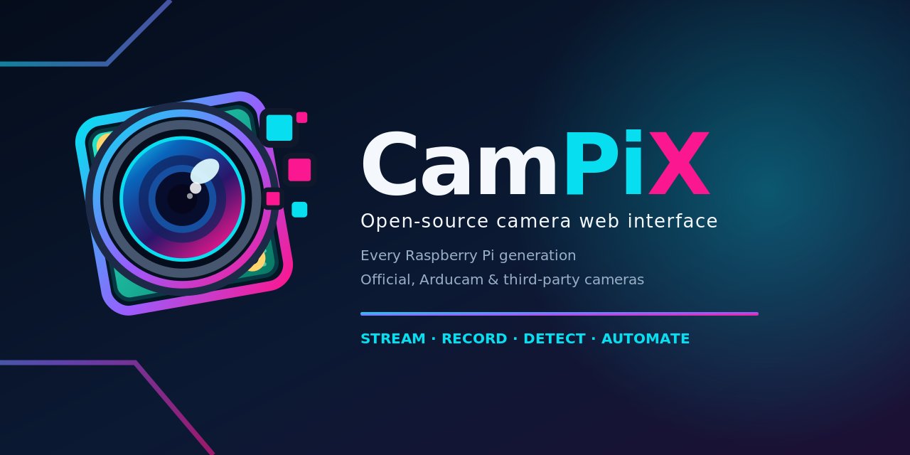

# CamPiX graphics and branding

[Project overview](../README.md) · [Documentation](../docs/README.md)

The supplied artwork establishes CamPiX's camera-lens identity and cyan, magenta, and violet palette. PNG files are ready for Markdown and social previews; corresponding SVG files are scalable sources. The supplied artwork has not been redrawn or recolored.

## Asset catalog

| Asset                                                                                            | Intended use                                                            |
| ------------------------------------------------------------------------------------------------ | ----------------------------------------------------------------------- |
| [GitHub banner](campix-github-banner-1600x520.png) · [SVG](campix-github-banner-1600x520.svg)    | Wide project header, 1600 × 520. Used in the main README.               |
| [Social preview](campix-social-preview-1280x640.png) · [SVG](campix-social-preview-1280x640.svg) | Repository/social sharing image, 1280 × 640.                            |
| [Square icon](campix-icon-512.png) · [SVG](campix-icon-512.svg)                                  | Application identity on an opaque background, 512 × 512.                |
| [Transparent icon](campix-icon-transparent.png) · [SVG](campix-icon-transparent.svg)             | Camera mark for placement on existing backgrounds.                      |
| [Transparent wordmark](campix-wordmark-transparent.png) · [SVG](campix-wordmark-transparent.svg) | Full project name with icon. Used in the documentation index.           |
| [Branding overview](previews/campix-branding-overview.png)                                       | Overview of the supplied identity and badge system.                     |
| [Design iteration 01](version/01.png) through [08](version/08.png)                               | Historical visual concepts, not screenshots of the running application. |

The web application serves its runtime icon and wordmark from `dist/assets/`. Source graphics in this directory remain the branding reference.

## Badges and compatibility claims

[Open source](badges/badge-open-source.svg), [live streaming](badges/badge-live-streaming.svg), and [motion detection](badges/badge-motion-detection.svg) are used in the README and linked to the relevant implementation information. PNG variants are available alongside the SVGs.

The supplied [Raspberry Pi](badges/badge-raspberry-pi.svg), [Arducam](badges/badge-arducam.svg), [camera clones](badges/badge-camera-clones.svg), [camera support](badges/badge-camera-support.svg), [libcamera](badges/badge-libcamera.svg), and [Picamera2](badges/badge-picamera2.svg) badges are branding assets, not evidence of physical-device testing. Claims such as “All Models,” “Compatible,” and “Supported” require a qualified scope and a recorded compatibility matrix. Do not use them as blanket release certification.

The banner and social preview describe the project's intended reach. Place them next to the actual [release status](../docs/RELEASE-READINESS.md) when making technical claims. Keep the project name **CamPiX** and preserve aspect ratio; do not stretch, crop away the wordmark, or label design concepts as live UI evidence.

## Rights and attribution

The source-code license is in [LICENSE](../LICENSE). No separate artwork-license or trademark grant is recorded in the supplied graphics directory. Confirm the supplied artwork's redistribution rights with its owner before external publication; do not infer third-party endorsement from camera or platform names.
